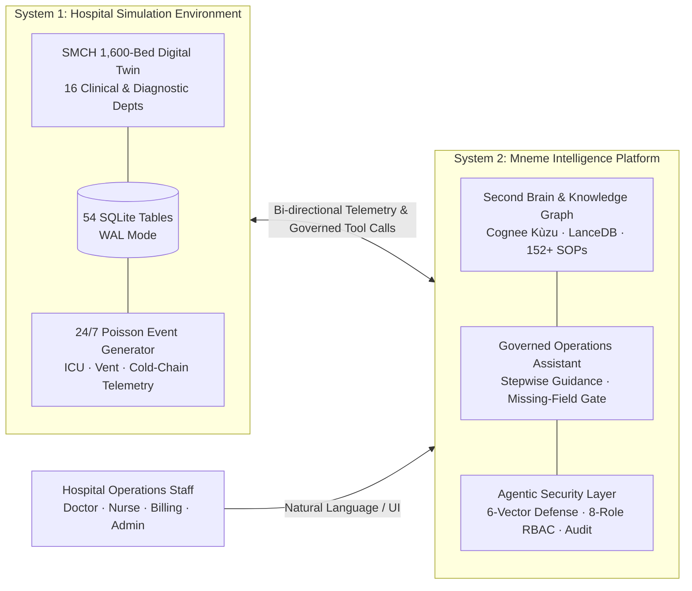

<div align="center">

# Mneme <sub>(Μνήμη)</sub>

**/ˈniː.miː/** • *noun* • Greek

### Autonomous Healthcare Operations Intelligence Platform & Second Brain

Transform fragmented hospital procedures, disconnected documentation, and administrative bottlenecks into grounded operational reasoning, stepwise workflow guidance, and provably secure agentic execution.

<sub>Built by **CyberPhantoms** for the Acentra **Hack to Care** Hackathon</sub>

</div>

> *"Deliberate well before venturing into an action; to say 'we will think about it' after starting is a flaw."* — Thirukkural 467 (Guiding principle of CyberPhantoms)

---

## Overview

Modern healthcare operations employees are overwhelmed by fragmentation — managing procedures, documents, reports, workflow engines, and support channels across disjointed legacy systems. **Mneme** addresses this challenge through a **two-system architecture**:



### The Two Systems

1. **The Hospital Simulation Environment (SMCH Digital Twin)**  
   A high-fidelity, live operational substrate simulating **Saveetha Medical College and Hospital (SMCH)** — a 1,600-bed, NABH-accredited tertiary teaching facility. Operating 24/7 in SQLite WAL mode across 54 tables, it generates dynamic clinical events in the cadence of a real hospital day: second-by-second ICU bedside telemetry, mechanical ventilator telemetry, IoT cold-chain temperature monitoring, 18 dialysis stations, walk-in emergency triages, and Ayushman Bharat PM-JAY claim adjudication.

2. **Mneme (The Governed Operations Assistant & Second Brain)**  
   The intelligent reasoning, memory, and governance platform that sits inside the simulation. Mneme ingests 152+ approved standard operating procedures (SOPs), policies, and clinical governance documents, synthesizes a dynamic operational ontology, provides source-cited stepwise workflow guidance, flags missing fields instead of making unsupported assumptions, routes high-stakes requests across 5 dedicated human teams, and provably defends against the 6 unique attack vectors of agentic AI.

---

## Features

### 🏥 System 1: Live Hospital Simulation Substrate
- **16 Clinical & Diagnostic Departments** — Emergency (P1/P2/P3 triage), OPD, IPD, ICU, OT (DaVinci Xi suite), LIS (Roche Cobas / Sysmex analyzer feeds), RIS/PACS, Pharmacy, Blood Bank (BBIS), Hemodialysis, Specialty Clinics, Billing/PM-JAY, Nursing, MRD, Biomedical CMMS, and Uncaptured Clinical Intelligence.
- **Continuous Bedside & IoT Telemetry** — Millisecond-level ICU vitals (HR, BP, SpO2, EtCO2, CVP), minute-level mechanical ventilator telemetry (PRVC, SIMV+PS), and IoT refrigerator sensors (2°C–8°C cold chain).
- **10-State Patient Journey Pipeline** — Tracks patients through `REGISTERED` → `TRIAGED` → `ADMITTED` → `UNDER_TREATMENT` → `INVESTIGATION` → `SURGERY` → `RECOVERY` → `DISCHARGE_PENDING` → `DISCHARGED` → `FOLLOW_UP`.
- **Interactive Simulation Controls** — Dynamic clock speed scaling (0.5× to 30.0×) and emergency scenario injection (`code_blue`, `mass_casualty`, `critical_lab_troponin`, `cold_chain_breach`, `near_miss_intercept`).

### 🧠 System 2: Mneme Operations Intelligence & Second Brain
- **Grounded Second Brain with Exact Citations** — Every response is strictly grounded in approved hospital policies with explicit citations (`[SMCH Policy Manual §ADM.101]`, `[NABH Emergency Standards §ED.401]`), eliminating model hallucinations.
- **Explicit Uncertainty Communication** — Computes visible confidence scores and proactively halts when data is incomplete or ambiguous, communicating limitations clearly rather than guessing.
- **Stepwise Workflow Guidance** — Walks staff through routine operational procedures one action at a time — presenting the immediate next step with context rather than dumping an overwhelming multi-step procedure.
- **Missing-Field Detector & Prompting** — If a workflow is initiated without required parameters, Mneme halts progression, marks the instance `BLOCKED`, and generates explicit prompts asking for the missing data instead of making unsupported assumptions.
- **5-Team Human Escalation Router** — Automatically classifies and routes complex or sensitive inquiries to specialized human teams:
  - **Account Management & Payer Liaison Team** *(Account-specific inquiries)*
  - **Clinical Governance & Medical Review Board** *(Clinical questions & medical boundaries)*
  - **Compliance, Legal & Senior Operations Team** *(Sensitive data, MLC records, bypasses)*
  - **Central Operations Triage Desk** *(Ambiguous or unclear requests)*
  - **Departmental Subject-Matter Specialist Desk** *(Low-confidence requests)*
- **6-Vector Agentic Security Defense**:
  1. *Prompt Injection Defense* — Strict data/instruction plane separation blocking DAN mode and prompt injection patterns.
  2. *Tool Privilege Escalation Defense* — Pre-execution role validation against an 8-Role RBAC Matrix.
  3. *Memory Poisoning Protection* — Schema and provenance validation on all Second Brain writes.
  4. *Irreversible Action Human Approval Gate* — High-consequence actions (`discharge_patient`, `approve_insurance_claim`, `cancel_surgery`, `authorize_surgical_entry`) are halted pending human authorization.
  5. *Cascading Confusion Defense* — Stateful task tracking halts progression on blocked steps rather than propagating errors.
  6. *Grounding Safety Anchors* — Core safety constraints and RBAC rules re-injected every 10 turns to prevent context drift.
- **Dynamic Operational Knowledge Graph** — Powered by Cognee with Kùzu graph storage, LanceDB vector embeddings (fastembed offline CPU), and real-time cross-departmental bottleneck radar.

---

## Architecture

```mermaid
flowchart TD
    subgraph UI["Interface & Interaction Layer"]
        DASH["Command Center Dashboard<br/>(http://localhost:8000)"]
        DOCS["Interactive Swagger API<br/>(/docs & /redoc)"]
        ONTO_UI["Knowledge Graph Explorer<br/>(/ontology)"]
        WS_LIVE["WebSocket Live Event Streams<br/>(/ws/live · /ws/icu)"]
    end

    subgraph SEC_LAYER["Layer 4: Agentic Security & Governance"]
        PI_FILTER["Prompt Injection Filter"]
        RBAC_GUARD["8-Role RBAC Matrix Validator"]
        GATE_ENGINE["Irreversible Action Gate"]
        AUDIT_LEDGER[("Append-Only Security Audit Log")]
    end

    subgraph AGENT_LAYER["Layer 3: Mneme Governed Agent Runtime"]
        INTENT_ENGINE["Intent Classification & Boundaries"]
        WORKFLOW_ENG["Stateful Workflow Engine"]
        MISSING_FIELD["Missing-Field Detector & Prompter"]
        ROUTER_5["5-Team Human Escalation Router"]
    end

    subgraph ONTO_LAYER["Layer 2: Operational Ontology & Second Brain"]
        KUZU_GRAPH[("Kùzu Structural Knowledge Graph")]
        LANCE_VEC[("LanceDB Dense Semantic Vectors")]
        KB_DOCS["152+ Ingested SOPs, Policies & Reports"]
        BOTTLENECK["Cross-Departmental Bottleneck Radar"]
    end

    subgraph SIM_LAYER["Layer 1: SMCH Hospital Simulation Substrate"]
        POISSON_SIM["24/7 Poisson Hospital Simulation Engine"]
        SQLITE_DB[("54 SQLite Tables (smch_hospital.db)")]
        BASE_DB[("14 Baseline Tables (hospital.db)")]
        TELEMETRY_BUS["Multi-Parameter Telemetry Bus"]
    end

    UI --> SEC_LAYER
    SEC_LAYER --> AGENT_LAYER
    AGENT_LAYER --> ONTO_LAYER
    ONTO_LAYER --> SIM_LAYER
```



---

## Tech Stack

| Layer | Technologies | Purpose |
| :--- | :--- | :--- |
| **Frontend & Command Center** | HTML5, Vanilla JavaScript, CSS3 (Dark Mode), Vis.js (`vis-network`), WebSockets | Real-time Operations Command Center, Knowledge Graph Explorer, and Bedside Telemetry Dashboard |
| **Backend & API Engine** | Python 3.12, FastAPI, Uvicorn (ASGI), Pydantic v2 | High-throughput asynchronous REST APIs, WebSocket feeds, and Server-Sent Events |
| **AI, Ontology & Second Brain** | Cognee, Kùzu Graph Engine, LanceDB, FastEmbed (`bge-small-en-v1.5`), Groq / Ollama / Qwen | Dynamic operational ontology, entity resolution, local CPU semantic embeddings, and governed reasoning |
| **Simulation Substrate** | Python `asyncio`, SQLite 3 (WAL Mode & Normal Sync), Poisson stochastic distribution | 24/7 real-time hospital event generation across 16 departments and 1,600 beds |
| **Security & Compliance** | Custom Regex Defense, 8-Role RBAC Matrix, Human-in-the-Loop Approval Queue | 6-Vector agentic AI safety defenses, irreversible action gating, and append-only audit ledger |
| **Document Processing** | `python-docx`, `openpyxl`, `reportlab` | Ingestion and synthesis of 152+ hospital SOPs, clinical policies, and Excel report workbooks |

---

## Local Development & Quickstart

### 1. Environment Setup

```bash
# Clone the repository
git clone git@github.com:Jaiyantan/acentra.git
cd acentra

# Create and activate Python virtual environment
python3 -m venv .venv
source .venv/bin/activate

# Install core runtime dependencies
pip install -r requirements.txt
```

### 2. Run the Unified Application

```bash
# Start the live simulation engine and Mneme assistant
python run_server.py
```

*The server initializes the 54-table SQLite schema, launches the 24/7 background simulation engine, and mounts all 23 departmental and governance routers on `http://127.0.0.1:8000`.*

### 3. Access Interactive Interfaces

- **Hospital Command Center UI**: [http://localhost:8000](http://localhost:8000)
- **Interactive Swagger API Documentation**: [http://localhost:8000/docs](http://localhost:8000/docs)
- **Operational Knowledge Graph Explorer**: [http://localhost:8000/ontology](http://localhost:8000/ontology)
- **Alternative ReDoc**: [http://localhost:8000/redoc](http://localhost:8000/redoc)

---

## Core Operational Endpoints & Capabilities

| Subsystem / Router | Base Route | Key Capabilities |
| :--- | :--- | :--- |
| **Emergency Department** | `/api/emergency` | Active triage queue (P1/P2/P3), 108 ambulance intake notes, door-to-doctor metrics |
| **Outpatient Department (OPD)** | `/api/opd` | Master patient index, room token queues across 16 specialties, ICD-10 e-prescriptions |
| **Inpatient Department (IPD)** | `/api/ipd` | 1,600-bed occupancy tracker, SOAP consultant ward notes, fluid I/O balance charts |
| **ICU & Critical Care** | `/api/icu` | Bedside multi-parameter telemetry, mechanical ventilator modes, ABG blood gas panels |
| **Operation Theatre (OT)** | `/api/ot` | Master surgical slate, DaVinci Xi robotic suite, WHO Surgical Safety Checklists |
| **Central Diagnostic Lab (LIS)** | `/api/laboratory` | Roche Cobas / Sysmex analyzer feeds, phlebotomy tracking, NABH critical panic alerts |
| **Radiology & PACS** | `/api/radiology` | 128-slice CT and 3T MRI worklist, DICOM acquisition metadata, radiation dosimetry |
| **Pharmacy & Cold Chain** | `/api/pharmacy` | Stock inventory, automated reorder triggers, refrigerator IoT telemetry (2°C–8°C), Schedule-X narcotics |
| **Blood Centre (BBIS)** | `/api/blood-bank` | ABO/Rh component stock (PRBC, FFP, Platelets), crossmatch clearance, freezer logs |
| **Hemodialysis Unit** | `/api/dialysis` | 18 live dialysis stations (Blood flow Qb, Dialysate Qd, TMP, accumulated UF volume) |
| **Specialty & Super-Specialty** | `/api/specialty` | Cath lab angiograms, daycare chemotherapy cycles, Multidisciplinary Tumor Boards |
| **Billing & PM-JAY** | `/api/billing` | Itemized bills, Ayushman Bharat PM-JAY claims via NHA TMS portal, TPA adjudication |
| **Nursing Administration** | `/api/nursing` | Ward rosters, live nurse-to-patient ratios, SBAR shift handovers, NABH incident audits |
| **Medical Records (MRD)** | `/api/mrd` | Master Patient Index (MPI), physical file archive rack locator, MLC legal register |
| **Biomedical CMMS** | `/api/biomedical` | Critical equipment asset register, uptime %, TNMC medical license renewal monitoring |
| **Uncaptured Intelligence** | `/api/uncaptured-gaps` | Order-to-execution latency tracking, near-misses, doctor unwritten clinical reasoning |
| **Workflow Automation** | `/api/workflows` | 8 JSON workflows, missing-field detection, 5-team human escalation routing |
| **Second Brain Knowledge Base** | `/api/knowledge` | Source-grounded RAG retrieval, policy citations, explicit uncertainty scoring |
| **Security & Governance** | `/api/security` | Append-only audit ledger, human approval queue, 1-click irreversible action clearance |
| **Patient Journey Pipeline** | `/api/patient-journey` | 10-stage lifecycle state machine (`REGISTERED` → `FOLLOW_UP`) |
| **Real-Time Streaming** | `/ws/live`, `/ws/icu` | High-frequency hospital event bus and millisecond-level ICU bedside telemetry streams |
| **Baseline 12 Endpoints** | `/patient/*`, `/beds/*` | The 12 baseline RBAC endpoints verifying `X-Staff-ID` header permissions |

> For the comprehensive catalog of all 23 routers, parameters, and models, see the [API Endpoints Reference](file:///home/kabe/Competions/acentra/docs/api/ENDPOINTS_REFERENCE.md).

---

## Repository Structure

```
acentra/
├── run_server.py                    # Unified single-command launcher (all 23 routers)
├── requirements.txt                 # Core runtime dependencies
├── requirements-dev.txt             # Development & testing dependencies
├── pyproject.toml                   # Project metadata, pytest & ruff configuration
├── .env.example                     # Environment configuration template
│
├── app/                             # Core Application Package
│   ├── config.py                    # Global configuration & multi-path database resolution
│   ├── database.py                  # SQLite schema definitions & connection pool
│   ├── main.py                      # FastAPI application & router orchestration
│   ├── engine/                      # Core Engines
│   │   ├── security_layer.py        # 6-Vector agentic AI security & 8-role RBAC matrix
│   │   └── workflow_engine.py       # Stateful stepwise workflow engine & escalation router
│   ├── simulation/                  # Real-Time Hospital Simulation Substrate
│   │   ├── engine.py                # 24/7 Poisson background event generator
│   │   ├── events_bus.py            # Asynchronous pub/sub event bus
│   │   └── patient_pool.py          # Synthetic clinical cohort generator
│   ├── ontology/                    # Operational Knowledge Graph & Second Brain
│   │   ├── builder.py               # Ontology node builder from HIS/LIS/KB
│   │   ├── models.py                # Graph node & edge schema dataclasses
│   │   ├── graph_service.py         # Kùzu graph persistence & Cypher query engine
│   │   ├── governed_agent.py        # Intent classification & safety reasoning
│   │   ├── semantic_search.py       # LanceDB vector search with fastembed
│   │   ├── kb_ingestion.py          # 152+ document ingestion pipeline
│   │   └── cognee_config.py         # Cognee & LLM provider configurations
│   ├── routers/                     # 23 Departmental & Governance API Routers
│   ├── static/                      # Hospital Command Center Web Dashboard
│   └── workflows/configs/           # Declarative JSON workflow definitions
│
├── data/                            # SQLite Storage & Schema Definitions
│   ├── smch_hospital.db             # Primary 54-table simulation database (4.9MB)
│   ├── hospital.db                  # Baseline 14-table sample database (128KB)
│   ├── schema.sql                   # Baseline SQLite DDL schema
│   └── seed.py                      # Synthetic seed data populator
│
├── knowledge_base/                  # Operational Knowledge Assets (Tier 2/3)
│   ├── Operations_Synthetic_Workbook.xlsx
│   ├── operations_requests.json, routing_rules.json, workflow_definitions.json
│   ├── knowledge_articles/, policies/, reports/, sops/, index/ (152+ docs)
│
├── docs/                            # Deep-Dive Technical Documentation
│   ├── architecture/                # SMCH Hospital Operations Data Model
│   ├── specs/                       # PS Deep Dive, Feature Checklist, Build Plan
│   └── api/                         # Complete Endpoints Reference Catalog
│
└── tests/                           # Automated Test Suite (24 Tests)
    ├── conftest.py                  # Test fixtures & staff authorization headers
    ├── test_baseline_api.py         # 12 RBAC baseline endpoints validation
    ├── test_departmental_routers.py # Clinical & operational department tests
    ├── test_security_engine.py      # Prompt injection & action gating tests
    └── test_workflow_engine.py      # Missing-field & escalation router tests
```

---

## Testing & Verification

Run the comprehensive test suite verifying the 12 baseline RBAC endpoints, clinical departments, agentic security layer, and workflow state engine:

```bash
pytest tests/ -v
```

```text
======================== 24 passed, 1 warning in 0.52s =========================
```

All 24 unit and integration tests execute completely locally with zero external network or cloud dependencies.

---

## Documentation Hub

- [SMCH Hospital Operations Data Model](file:///home/kabe/Competions/acentra/docs/architecture/SMCH%20Hospital%20Operations%20Data%20Model.md)
- [Problem Statement Deep Dive: Word by Word](file:///home/kabe/Competions/acentra/docs/specs/PS%20Deep%20Dive%20Word%20by%20Word.md)
- [Feature Checklist: Must Have vs May Have](file:///home/kabe/Competions/acentra/docs/specs/Feature%20Checklist%20Must%20Have%20vs%20May%20Have.md)
- [Hack to Care Build Plan](file:///home/kabe/Competions/acentra/docs/specs/Hack%20to%20Care%20Build%20Plan.pdf)
- [Complete API Endpoints Reference](file:///home/kabe/Competions/acentra/docs/api/ENDPOINTS_REFERENCE.md)

---

## Team — CyberPhantoms

- **Ranen Joseph Solomon**
- **Jaiyantan**
- **Thirumurugan**
- **Kabelan**

---

## License

Released under the [MIT License](LICENSE) © 2026 CyberPhantoms.
